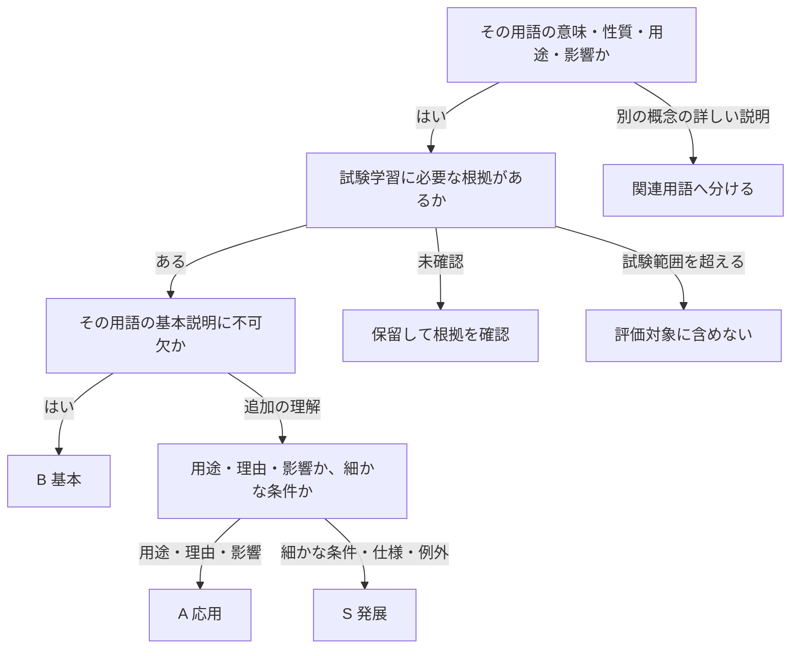

# 用語評価の基準

B・A・Sは、**試験で必要な理解の深さ**で分ける。この基準で用語ごとの学習範囲と段階を判断する。

用語データ・画面の段階説明・AIへの評価指示に共通して適用する。出題頻度だけで段階を決める方式から見直した。

## 最初に評価する範囲を決める

「1用語につき1概念」の範囲には、その概念の用途・理由・影響も含められる。例えば量子コンピュータが暗号に与える影響は扱えるが、PQCの定義や各方式の仕組みまで一括で答えることは要求しない。

## B・A・Sの境界

| 段階 | 確かめること | 項目にする目安 | 含めすぎになる例 |
|---|---|---|---|
| B：基本 | 何か、何のためか、基本の仕組み | これが抜けると、その用語の意味が伝わらない・別の概念と取り違える | 成立する短い定義に、実装の細部まで必須にする |
| A：応用 | どこで使うか、なぜそうなるか、何に影響するか | 基本を踏まえ、試験で問われる用途・理由・制約・影響を説明できる | 関連する別の用語の定義や手順を丸ごと要求する |
| S：発展 | 細かな条件・仕様・例外 | 試験範囲内の具体的な根拠があり、その用語の説明をさらに正確にできる | 専門家向けの数学・物理・実装知識を、難しいという理由で追加する |

用途や理由でも、それが用語の定義に不可欠ならBにする。例えば「署名者の秘密鍵で生成し、公開鍵で検証する」は、ディジタル署名の基本に含める。

出題頻度は学習の優先順位を決める参考情報として扱う。頻度の低さだけでSにしたり、頻出というだけで細部をBにしたりしない。

## 項目を採用する根拠

| 根拠 | 判断できること | 判断できないこと |
|---|---|---|
| IPAの過去問の問題文・正答・選択肢 | どの論点を区別して答える必要があるか | 用語が登場しただけで、その専門分野全体が必要とは判断しない |
| IPAのシラバス・出題範囲 | どの概念を学習対象に含めるか | 用語名の掲載だけでは、あらゆる細部を要求する根拠にならない |
| 公的機関・規格・開発元などの一次資料 | 内容の正確さ、成立条件 | 資料に詳しく書かれているだけでは、試験上の必要性や段階は決められない |

根拠は論点に対応させる。過去問なら年度・期・科目・問番号と該当箇所を示す。出題根拠が未確認の追加論点は保留し、AやSへ仮置きして学習者に要求しない。

## 項目の作り方

| 確認事項 | 基準 |
|---|---|
| 1項目の範囲 | 1つの論点。原因とその直接の結果は一緒に扱える |
| 項目数 | 必要な分だけ。B・A・Sの個数をそろえない |
| 段階の有無 | Bだけ、BとAだけでも成立する。Sを必ず作らない |
| 説明の表現 | 意味・関係が説明できていれば、言い換えを認める |
| 固有名詞 | 名称そのものが論点の場合に求める。アルゴリズム名などを飾りとして必須にしない |
| 説明の長さ | 長文、専門用語の多さ、関連語の数を加点根拠にしない |
| 定義・説明例 | 評価対象と同じ範囲にそろえる。参考例の細部を暗黙の必須条件にしない |

編集時には、各項目について「段階」「その段階にした理由」「根拠」「これだけ説明できれば十分という例」を残す。追加論点では、どこまで要求しないかも明らかにする。段階と論点は用語データの`criteria`、中心的な意味と説明例は`definition`と`example`に記す。レビューの理由と出題範囲の根拠は[用語集の見直し記録](glossary-review.md)にまとめる。

## 量子コンピュータでの判断例

以下の範囲を用語データにも適用する。

| 段階 | 評価する論点 | 十分な説明の例 | 求める範囲の境界 |
|---|---|---|---|
| B | 量子ビットの重ね合わせを使って計算する | 「量子ビットの重ね合わせなど、量子の性質を利用して計算するコンピュータ」 | 状態ベクトルや数式は要求しない |
| A | 特定の問題の高速化が、RSAなど一部の公開鍵暗号の安全性に影響する | 「十分な規模の量子コンピュータでは、RSAなどの解読が速くなる可能性がある」 | 個別アルゴリズム名・数式・PQCの各方式の説明は要求しない |
| S | 現時点では設けない | — | 量子もつれや量子アニーリングを、段階を埋めるために追加しない |

Bの根拠は[令和6年度春期・午前Ⅰ問4の収録内容](../src/data/sc-2024-spring-a1.ts)。Aは、[令和7年度秋期・SC午前Ⅱ問3の収録内容](../src/data/sc-2025-autumn-a2.ts)で扱う暗号への影響と対応し、仕組みの説明から一歩進んだ論点として位置付ける。十分な規模の量子コンピュータがRSAや楕円曲線暗号に与える脅威は、[NISTの説明](https://pages.nist.gov/nccoe-migration-post-quantum-cryptography/)でも確認できる。

## 評価結果の扱い

誤字・脱字・表記ゆれ・近い音の誤変換・助詞の誤りは、入力方法にかかわらず、前後の語と動作から自然に読み取ってから内容を評価する。誤字だと断定できることや、解釈の完全な一意性までは要求しない。用語資料は表記の特定に使えるが、説明していない知識を足すためには使わない。表記の不正確さだけを理由に不足・誤りと判定したり、意味の理解への確信を下げたりしない。明確な言い直しは訂正後を評価する。自然に読んでも必要な意味を確認できない場合は未説明とし、内容の取り違えが残る場合は誤りとして扱う。

文末が「〜を悪用して」などで途切れていても、対象と動作で項目の意味が伝われば認める。各項目を独立して評価し、別項目の未説明や文章全体の未完結を理由に、伝わった項目を未説明にしない。読み取った意味が同じなら、誤字のない文章と同じ選択・確率で評価する。

音声入力を使った説明は、音声認識の書き起こしを含むことをAIに明示する。漢字や表記を読みの音に戻し、同音・近い音の語、長音・促音・濁音や語の区切りのずれを許容する。例えば「ハシュち」は前後の説明から「ハッシュ値」として読める場合に認める。音の近さだけで内容を合格にせず、説明された対象・動作・関係を評価する。文字入力にも、音声入力からの貼り付けなどで同様の誤りが含まれる場合があるため、同じ読み取り方針を適用する。

認識結果が別の普通の日本語になっていても、用語・項目と読みの近さから発話した専門用語として復元してよい。ROC曲線の説明にある「利用成立（りようせいりつ）」は「偽陽性率（ぎようせいりつ）」として読む。短い説明でも許容するが、縦軸・横軸や肯定・否定、数値、主語と対象の対応は書かれたまま評価する。「横軸を利用成立、縦軸を真陽性率」は軸の項目を満たす一方、「縦軸を利用成立」は「縦軸を偽陽性率」と復元した上で軸の誤りとして扱う。

説明は原文のままAIへ送信する。音と文脈から読み替えてよいことを採点指示で伝え、個別の用語をコードで固定置換しない。項目の一部に明確な内容の誤りがある場合は、他の部分が未説明でも誤りを優先して示す。

| 説明の例 | 読み取り・期待する判定 |
|---|---|
| 署名者の秘密かぎで署名を作る | 「秘密鍵」として署名生成の項目を評価する |
| 暗号文を複合して平文に戻す | 「復号」として平文に戻す意味を評価する |
| パスワードのハッシュ時だけをみて認証する仕組みは悪用して | 「ハッシュ値だけで認証できる仕組みを悪用する」は説明できた。「解読せずそのまま認証に使う」は未説明 |
| 公開鍵、ではなく署名者の秘密鍵で署名を作る | 訂正後の秘密鍵による署名生成を評価する |
| 鍵で署名する | 秘密鍵か確認できず、署名生成の項目は未説明 |
| 署名者の公開鍵で署名を作る | 秘密鍵との取り違えで、署名生成の項目は誤り |
| 秘密鍵でも公開鍵でも署名を作れる | 訂正されていない矛盾があり、署名生成の項目は誤り |

上の例は採点指示の調整・確認に使う期待値であり、実際のモデル出力による検証結果ではない。実APIで比較する入力・期待値と実行方法は[誤字・脱字の評価確認](glossary-evaluation-checks.md)に記す。

新しいDecisions APIの評価では、各項目の`choice`だけで判定する。`covered`は「説明できた」、`missing`は「未説明」、`review`は「内容に誤り」としてそのまま採用する。推定確率の下限を設けず、`probabilities`や`confidence`で選択を変更しない。新しい評価には選択だけを保存し、これらの確率情報の欠落や形式を採用条件にしない。項目IDと選択の形式・項目数・拒否は引き続き検証する。

保存済みの評価は当時の判定を残し、過去に適用した確率の下限・確率情報・判定保留は履歴とバックアップで維持する。新しい評価に下限や判定保留は設けない。

| 説明できた範囲 | 評価 |
|---|---|
| Bに不足がある | C |
| Bを満たした | B |
| Bと、設定されたAを満たした | A |
| B・Aと、設定されたSを満たした | S |

実際に設定された段階だけを判定する。Bだけの用語の最高評価はB。A・Sの不足だけでBを未達扱いにしない。内容の誤りは未説明と分けて指摘する。どの段階でも明確な誤りがある場合は、現行の判定と同じくCとして訂正点を示す。

既存の保存済み評価は、当時の基準による記録として残す。
